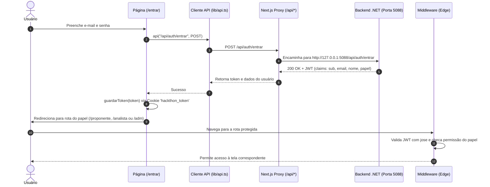

# Arquitetura do Frontend

Documento técnico da arquitetura, padrões de projeto e diretrizes de desenvolvimento da interface web do **Hackthon Web** (Hackathon STS 2026 - Lei do Bem).

---

## 1. Visão Geral

A interface web foi desenvolvida com **Next.js 15 (App Router)** e **TypeScript**, atuando de maneira totalmente desacoplada da API backend (.NET 8).

A aplicação segue uma abordagem onde:
- A comunicação com a API ocorre via **proxy reverso interno** no Next.js (evitando problemas de CORS e mantendo o mesmo domínio).
- O controle de acesso é aplicado de forma híbrida: **na borda (Edge Middleware)** e nos **componentes de casca autenticada**.
- A interface é desenhada com um design system baseado em **Neumorfismo** utilizando **Chakra UI v3** e **Tailwind CSS v4**, respeitando as diretrizes de acessibilidade e a identidade visual do Banco do Nordeste.

---

## 2. Estrutura de Camadas

```text
src/
├── app/                  # Roteamento e Páginas (App Router)
│   ├── (rotas públicas)  # /, /entrar, /cadastrar
│   └── (rotas protegidas)# /proponente, /analista, /adm, /adm/novo
├── components/           # Camada de Apresentação e Componentes
│   ├── casca.tsx         # Shell autenticada padrão
│   ├── tela-acesso.tsx   # Shell para páginas de auth
│   ├── botoes.tsx        # Botões padronizados (primário, secundário, quieto)
│   ├── campo.tsx         # Inputs, labels e mensagens de validação
│   └── estados.tsx       # Componentes de Loading e Erro com retry
├── lib/                  # Camada de Domínio, Infraestrutura e Serviços Web
│   ├── api.ts            # Cliente HTTP com interceptação e Problem Details
│   ├── sessao.ts         # Manipulação de cookies de sessão
│   ├── papeis.ts         # Regras e rotas por papel (RBAC)
│   ├── tipos.ts          # Tipos e contratos de dados
│   └── segredo-dev.ts    # Configurações de token para desenvolvimento local
├── middleware.ts         # Interceptador de requisições no Edge Runtime
└── theme.ts              # Configuração do Chakra UI Provider
```

### Responsabilidades por Módulo

| Módulo | Responsabilidade |
| --- | --- |
| **`app/`** | Define as páginas, layouts específicos, tratamento de erros de rota (`error.tsx`), carregamento (`loading.tsx`) e página não encontrada (`not-found.tsx`). |
| **`components/`** | Componentes puros e visuais. Isola regras de estilização e garante consistência visual em todo o projeto. |
| **`lib/api.ts`** | Centraliza todas as chamadas HTTP, anexando o cabeçalho `Authorization: Bearer <token>` e mapeando erros RFC 7807 (Problem Details). |
| **`lib/sessao.ts`** | Gerencia o ciclo de vida do cookie `hackthon_token` no navegador (`guardarToken`, `lerToken`, `limparToken`). |
| **`middleware.ts`** | Valida tokens e permissões de rotas antes mesmo de iniciar o processamento da página. |

---

## 3. Autenticação e Controle de Acesso (RBAC)

O sistema implementa **Role-Based Access Control (RBAC)** rígido para três papéis: `Proponente`, `Analista` e `Adm`.

### Fluxo de Autenticação



### Regras do Middleware (`src/middleware.ts`)

1. **Rotas Públicas:** `/`, `/entrar`, `/cadastrar`. Se um usuário já logado acessar essas rotas, é redirecionado automaticamente para o painel correspondente ao seu papel.
2. **Rotas Protegidas:**
   * `/proponente/*` $\rightarrow$ requer papel `Proponente`.
   * `/analista/*` $\rightarrow$ requer papel `Analista`.
   * `/adm/*` $\rightarrow$ requer papel `Adm`.
3. **Não Autenticado:** Qualquer tentativa de acessar rota protegida sem cookie redireciona para `/entrar`.
4. **Papel Incompatível:** Usuário autenticado que tente acessar rota de outro papel é redirecionado para a home do seu respectivo papel.

### Hidratação e Validação em Tempo Real (`Casca.tsx`)

Além do middleware na borda, o componente de layout autenticado [`Casca`](../src/components/casca.tsx) consulta `/api/auth/eu` no momento em que o componente é montado. Isso garante que:
- O perfil e status da conta são validados em tempo real com o banco de dados.
- Caso a conta tenha sido desativada por um administrador, a API retorna `401` ou `403`, o token é imediatamente limpo e o usuário é redirecionado para a tela de login.

---

## 4. Integração com a API Backend

### Proxy Reverso (Next.js Rewrites)

O arquivo [`next.config.ts`](../next.config.ts) define um rewrite automático:

```typescript
async rewrites() {
  return [
    {
      source: "/api/:path*",
      destination: `${apiInterna}/api/:path*`,
    },
  ];
}
```

Isso garante que:
* As chamadas partem de `http://127.0.0.1:43123/api/...` e não exigem configuração de CORS no backend para origens dinâmicas.
* Cookies enviados na mesma origem são manipulados de forma segura e transparente.

### Tratamento Padronizado de Erros

A função [`api<T>()`](../src/lib/api.ts) intercepta respostas de erro e extrai a mensagem do formato RFC 7807 (*Problem Details*) adotado pelo backend:
```typescript
if (!resposta.ok) {
  const detalhe = corpo?.detail || corpo?.title || "A operação não foi concluída.";
  if (resposta.status === 401 && !entrada && caminho !== "/api/auth/eu") {
    limparToken();
  }
  throw new ErroApi(detalhe, resposta.status);
}
```

---

## 5. Design System e Interface CRM

O projeto adota uma estética de **Neumorfismo leve e funcional**, focada em densidade de dados e profissionalismo para ambientes corporativos:

- **Componentes de Contêiner Neumorphic:**
  - `.neo`: Superfícies elevadas com sombras suaves côncavas/convexas (`8px 8px 18px #c8cad1`, `-8px -8px 18px #ffffff`).
  - `.neo-inset`: Superfícies rebaixadas para inputs, cartões de métricas secundárias e containers de detalhes.
- **Identidade Visual:**
  - Destaque em tom vermelho institucional (`#C4161C` e `#8E1218`) associado ao Banco do Nordeste.
  - Paleta base em cinzas suaves (`#E6E7EB`, `#F3F4F7`, `#E7E9EE`) que garantem contraste e conforto visual.
  - Textos de alto contraste (`#2C3138` e `#5E6570`).

### Padrão CRM (Analista e ADM)
1. **Métricas e KPIs no Topo:** Indicadores operacionais imediatos (propostas em triagem, em análise, elegíveis, dispêndios totais e economia fiscal estimada).
2. **Barra de Ferramentas CRM:** Busca instantânea no client-side combinada com filtros categóricos (status, área tecnológica e situação cadastral).
3. **Visão 360° do Caso (Dossiê):** Modal com os 5 critérios do **Manual de Frascati** (Incerteza, Novidade, Criatividade, Sistematicidade, Reprodutibilidade) para fundamentação de parecer técnico auditável.
4. **Governança Segura:** No ADM, qualquer troca de papel ou desativação de conta é registrada na transação do banco com rastro imutável.

### Jornada do Proponente (Conversão e Indução)
1. **Landing Page (`/`):** Explicação detalhada da **Lei do Bem (Lei 11.196/05)**, vantagens fiscais (dedução de até 34% no IRPJ/CSLL), jornada em 4 etapas e simulador interativo em tempo real para incentivar o autocadastro.
2. **Central do Proponente (`/proponente`):** Painel orientador que instrui o usuário sobre o que o analista avaliará e disponibiliza modal interativo para submeter projetos de P&D diretamente à esteira técnica.

---

## 6. Comandos e Execução com Yarn

Todos os scripts do projeto utilizam o gerenciador **Yarn**:

```bash
# Instalação das dependências
yarn install

# Desenvolvimento local (porta 43123)
yarn dev

# Compilação e verificação estática de tipos
yarn build

# Execução do build de produção
yarn start

# Linter de código
yarn lint
```

